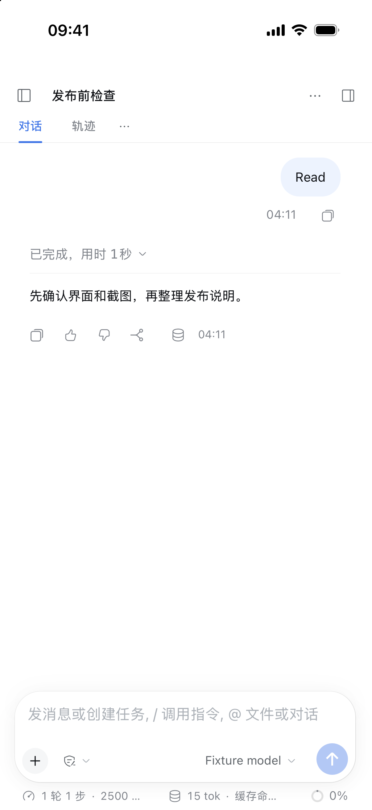
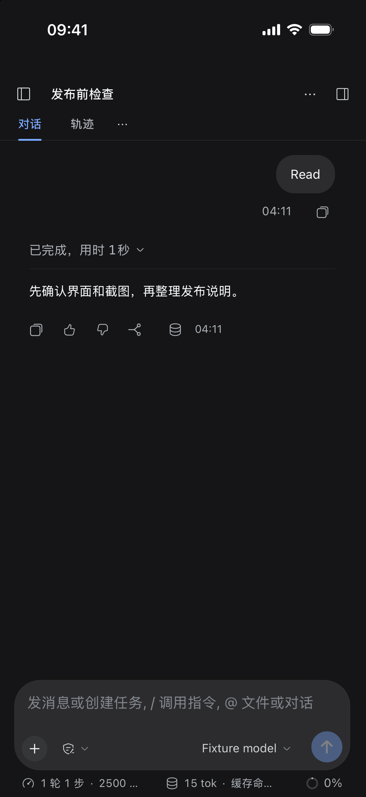

# dsh-ios-top-clearance

[简体中文](README.zh.md)

Keeps the DSH phone header below the iOS Home Screen web app's top blur band.

On iOS 26 and later, in the standalone Home Screen app (`navigator.standalone === true`)
at phone widths (`max-width: 767px`), the plugin insets `#root` by 16 px so the title row
and drawer opener clear the system scroll-edge blur.
Browser tabs, Desktop, and internal frame layouts stay untouched.

Requires DeepSeek Harness `0.2.2-rc.3` or newer.
Enable **iOS top clearance** in **Mobile Modular Improvement Plan**, or install standalone from a checkout:

```sh
pnpm install
dsh plugin --profile web add link:/path/to/plugins/dsh-ios-top-clearance
```

Reload the Home Screen app after installing.
To uninstall: `dsh plugin --profile web remove @miorin/dsh-ios-top-clearance`.

## Simulator screenshots

Captured on an iPhone 17 Pro simulator running iOS 26.4 (Chinese UI), showing a 16 CSS px downward shift compared
to the disabled state.

| Light | Dark |
| --- | --- |
|  |  |

[Light theme with the plugin turned off](docs/assets/screenshots/off-light.png)

[Project documentation](docs/README.md)
