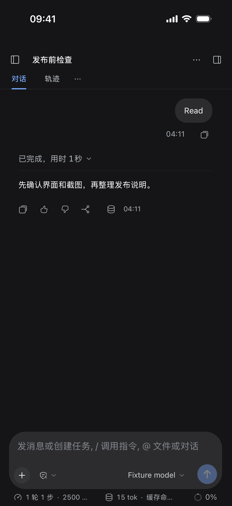

# dsh-ios-top-clearance

[English](README.md)

把 DSH 手机版顶部标题栏移出 iOS 主屏幕应用的系统模糊带。

在 iOS 26 及以上版本中，仅当以主屏幕独立应用运行（`navigator.standalone === true`）且视口宽度不超过 767 px 时，
插件将 `#root` 向下让出 16 px，使标题行与抽屉开关避开顶部的系统滚动边缘模糊带。
浏览器标签页、桌面端与 frame 内部布局均不受影响。

需要 DeepSeek Harness `0.2.2-rc.3` 或更新版本。
可在 **移动端模块化改良计划** 中直接开启 **iOS 顶部留白**，或在本地源码目录构建后安装到 Web profile：

```sh
pnpm install
dsh plugin --profile web add link:/path/to/plugins/dsh-ios-top-clearance
```

安装后重新打开主屏幕应用即可生效；卸载可运行 `dsh plugin --profile web remove @miorin/dsh-ios-top-clearance`。

## 模拟器实拍

以下截图来自 iPhone 17 Pro 模拟器（iOS 26.4），同一会话开启插件后标题与抽屉开关整体下移 16 CSS 像素（验证位移，
不代表真机系统模糊效果）。

| 关闭插件（浅色） | 开启插件（浅色） | 开启插件（深色） |
| --- | --- | --- |
|  |  |  |

[项目文档](docs/README.md)
